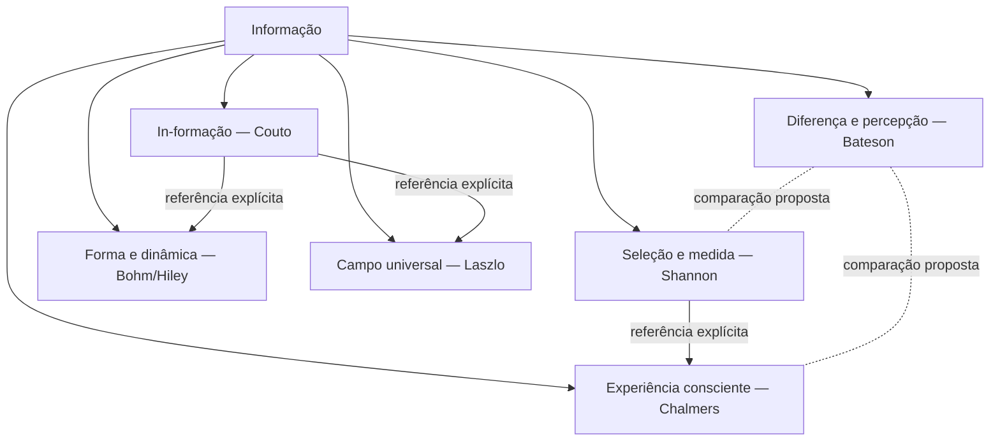

# Lumora — Mapa Conceitual de Conhecimento 001: Informação

**Versão:** 0.1 · **Data:** 24/11/2026 · **Estado:** investigação bibliográfica em elaboração.

**Pergunta central:** O que é a informação, como ela se relaciona com a forma e o que acontece quando um sistema a recebe?

## 1. Escopo e critérios de leitura

Este documento inaugura uma coleção de mapas de conhecimento para a possível plataforma educacional Lumora. Complementa os mapas de coerência e de evidências educacionais, mas não define currículo, arquitetura técnica ou doutrina. O recorte parte de Hélio Couto e investiga sentidos distintos do conceito de informação. As fontes da biblioteca são consultadas em seus próprios termos; as referências externas são identificadas separadamente. Uma ligação conceitual não demonstra equivalência entre teorias, nem a eficácia de uma tecnologia espiritual.

## 2. Núcleos conceituais

### INF-01 — In-formação e forma

**Fonte:** COUTO, Hélio. *Mentes In-Formadas: ondas de in-formação, transferência de consciências arquetípicas e outras infinitas possibilidades*. Linear B, edição gratuita em PDF, fevereiro de 2017 (primeira edição de 2015). Parte IV, “In-Formação e Consciência”, subseção “Definição”, p. 272; “Transferência de In-formação”, a partir da p. 282. [Arquivo da biblioteca](https://drive.google.com/file/d/1paJbhMaAUg3Wbz6lnS4My9wp9xvM3cti/view).

**Trecho:** “Informar (do latim informare) significa prover uma forma, moldar segundo uma forma.”

**Formulação:** Couto distingue informação como dados sobre algo de informação como princípio que confere identidade e organização às coisas. O livro associa esse sentido à possibilidade de transferir in-formação por ondas e cita Ervin Laszlo, Bohm e Wheeler. Na subseção sobre transferência, introduz a espectroscopia como referência.

**Natureza:** interpretação metafísica e espiritual articulada com conceitos científicos. A espectroscopia permite obter dados sobre sistemas materiais por interação com radiação; isso não demonstra transferência de conhecimentos, habilidades ou consciências por ondas.

**Questão:** como distinguir a informação que descreve uma estrutura, as relações que constituem essa estrutura e a hipótese de um princípio universal que a forma?

### INF-02 — Informação como seleção entre possibilidades

**Fonte externa primária:** SHANNON, Claude E. A Mathematical Theory of Communication. *Bell System Technical Journal*, v. 27, 1948, p. 379–423 e 623–656. Introdução e seções 6 e 12. [Texto integral](https://www.organism.earth/library/document/mathematical-theory-of-communication).

**Formulação:** o problema matemático da comunicação envolve reproduzir, em um ponto, uma mensagem selecionada em outro. Shannon trata a seleção entre alternativas, as probabilidades, a codificação e a transmissão sob ruído, deixando o significado semântico fora desse problema específico. A entropia H = −Σ pᵢ log₂ pᵢ mede a incerteza média de uma fonte discreta, em bits.

**Natureza:** teoria matemática formalizada, com aplicações verificáveis em engenharia da comunicação.

**Questão:** duas mensagens que possuem a mesma quantidade de informação matemática podem ter valores e significados completamente diferentes para um leitor?

### INF-03 — Informação como diferença relevante

**Fonte:** BATESON, Gregory. *Mente e Natureza: a unidade necessária*. Tradução de Claudia Gerpe. Francisco Alves, 1986. Original de 1979. Capítulo II, discussão sobre percepção de diferenças (p. 35); capítulo III, exemplo da visão binocular; glossário, verbete Informação. [Arquivo da biblioteca](https://drive.google.com/file/d/1U9KRhiiBLSlM6oKKbAPbhYqk6EkvYhbG/view).

**Trecho do glossário** (acentuação normalizada devido à extração imperfeita): “Qualquer diferença que faz uma diferença.”

**Formulação:** a percepção depende de diferenças que podem ser registradas pelo sistema. No exemplo da visão binocular, a diferença entre as imagens das duas retinas permite obter informação adicional sobre profundidade. A relação entre sinais produz uma distinção que um sinal isolado não oferece.

**Natureza:** epistemologia sistêmica e cibernética, com exemplos de processos perceptivos. A definição não é uma fórmula de medida em bits.

**Questão:** em que condições uma diferença existente no ambiente se torna relevante para um organismo, um estudante ou um sistema técnico?

### INF-04 — Informação ativa e forma na física

**Fonte complementar:** análise acadêmica “David Bohm’s philosophy of science in his causal interpretation of quantum mechanics”, *Synthese*, 2025. [Artigo](https://doi.org/10.1007/s11229-025-05139-8). Complemento: [Bohmian Mechanics, Stanford Encyclopedia of Philosophy](https://plato.stanford.edu/entries/qm-bohm/).

**Formulação:** no desenvolvimento da interpretação causal da mecânica quântica por Bohm e Hiley, a expressão informação ativa está ligada ao modo como a forma da onda participa da dinâmica das partículas. A análise de 2025 explica a distinção entre a forma da onda e sua magnitude nesse contexto.

**Natureza:** interpretação física formalizada e discussão filosófica. A mecânica bohmiana não estabelece que estados de consciência sejam transferíveis por ondas.

**Limite:** o PDF *A Ordem Implicada* da biblioteca retornou texto corrompido. Este núcleo é provisório e depende das referências externas, não de uma leitura direta verificável daquele livro. Recomenda-se recuperar uma edição legível e consultar *The Undivided Universe* (Bohm e Hiley, 1993).

**Questão:** o que significa “forma” na expressão informação ativa, e em que ela difere dos sentidos empregados por Couto e Shannon?

### INF-05 — Informação e experiência consciente

**Fonte:** CHALMERS, David J. “O enigma da experiência consciente”. Tradução de Luís M. S. Augusto, *Crítica*, 2/7/2016. Seção “Informação: física e experiencial”, páginas 7–8 do PDF. [Arquivo da biblioteca](https://drive.google.com/file/d/1JxS-Dm0nkKPezTBXK2vNuJsF0QRiwemV/view).

**Formulação:** Chalmers distingue o processamento de informação e as funções cognitivas do problema de explicar por que existe experiência subjetiva. Conjectura que a informação possa ter aspectos físicos e experienciais, relacionando a hipótese à teoria de Shannon. A discussão do termostato mostra que a presença de informação em um sistema não resolve automaticamente a questão da consciência.

**Natureza:** filosofia da mente e hipótese teórica, não conclusão experimental sobre a consciência de máquinas ou objetos.

**Questão:** descrever a informação que um sistema processa é suficiente para explicar aquilo que ele experimenta?

### INF-06 — Informação como campo universal

**Fonte:** LASZLO, Ervin. *A Plenitude do Cosmos* (original: *The Self-Actualizing Cosmos*, 2014). Cultrix, edição brasileira de 2018. Passagens sobre propriedades do campo e diálogo sobre inteligência no Akasha. [Arquivo da biblioteca](https://drive.google.com/file/d/1OYKvSQrd7hzXmzYHG8d4CsTMBQ_-vzlz/view).

**Formulação:** Laszlo propõe um campo universal com armazenamento holográfico de informação e efeitos não locais. No diálogo sobre Akasha, atribui à informação função formadora sobre mente e corpo.

**Natureza:** proposta cosmológica e metafísica especulativa, não um campo físico empiricamente estabelecido. Não é fundamento suficiente para aplicações médicas ou alegações de cura.

**Limite:** Couto cita *A Ciência e o Campo Akáshico*, uma obra diferente da consultada aqui. O mapa não confirma a exatidão da citação indireta nem atribui a esta obra os trechos daquela.

**Questão:** quais consequências observáveis diferenciariam um campo informacional universal de explicações físicas e cognitivas convencionais?

## 3. Relações conceituais

| Relação | Tipo | Limite |
|---|---|---|
| Couto → Laszlo | Referência explícita em Couto; proximidade temática | A obra de Laszlo consultada é diferente da citada por Couto. |
| Couto → Bohm | Referência explícita em Couto | A interpretação metafísica de Couto não decorre automaticamente da física bohmiana. |
| Shannon → Chalmers | Referência explícita em Chalmers | A teoria matemática é ponto de partida para uma conjectura filosófica, não sua demonstração. |
| Shannon ↔ Bateson | Comparação proposta: seleção, distinção e diferença | Medida matemática e relevância para um sistema são questões distintas. |
| Bateson ↔ Chalmers | Comparação proposta: percepção e processamento | Processos perceptivos não resolvem por si sós o problema da experiência subjetiva. |
| Couto ↔ Bateson | Comparação proposta: informação e mudança no receptor | Aprender por experiência não demonstra transferência espiritual de conhecimento por ondas. |

### Representação esquemática

As seis ramificações são perspectivas de investigação, não etapas obrigatórias de aprendizagem. As relações de referência representam uso de um autor pelo outro, não validação das respectivas conclusões.

## 4. Uma experiência educacional possível (proposta, não desenvolvida)

**Pergunta:** quando uma diferença passa a ser informação?

Uma pessoa observa duas mensagens de mesmo tamanho: “A reunião mudou para as 14h” e “A reunião mudou para as 15h”. Para quem participará dela, a diferença altera sua ação; para quem não participa, pode não ter relevância. Em um segundo exemplo, compara as duas imagens de um objeto obtidas de pontos de vista distintos, identificando o que a relação entre elas permite perceber. A atividade distingue transmissão, relevância e compreensão. Ela não mede expansão espiritual ou transferência de consciência.

**Possíveis conexões:** codificação, significado, percepção, atenção, contexto, aprendizagem, decisão. O estudante poderá escolher quais investigar a seguir.

**Critério de aprendizagem proposto:** explicar com exemplos próprios por que a quantidade matemática de informação não é a mesma coisa que significado ou relevância para alguém. Não se exige adesão a uma crença.

## 5. Questões que permanecem abertas

- Como informação, energia, matéria, significado e conhecimento se distinguem em cada domínio?
- Como o conhecimento se constrói por interpretação, experiência e feedback? Consultar fontes específicas de cognição e aprendizagem.
- Como a informação funciona nas teorias da comunicação social? A coletânea *Niklas Luhmann: a nova teoria dos sistemas* foi localizada e acessada, mas os trechos relevantes não foram recuperados com segurança nesta etapa; consultar edição mais legível.
- Como Wheeler formula “it from bit” no texto original? A referência indireta em Couto não foi verificada.
- Quais afirmações de *Mentes In-Formadas* admitem avaliação empírica e quais dependem de premissas metafísicas? Recuperar os estudos primários citados antes de formular conclusões.

## 6. Próximo recorte sugerido

Investigar a relação **informação → percepção → conhecimento**, aprofundando Bateson (percepção de diferenças) e acrescentando referências específicas de psicologia cognitiva e filosofia da linguagem. Alternativamente, o leitor pode explorar primeiro a relação entre informação e forma na física, a partir das fontes originais de Bohm e Hiley. Nenhum desses percursos constitui pré-requisito universal.

## 7. Registro da pesquisa e limites

Foram examinadas passagens selecionadas dos arquivos de Couto, Bateson, Chalmers e Laszlo na biblioteca do Drive, além de referências públicas sobre Shannon e Bohm. As tentativas de extração de Bohm e de busca de trechos em Luhmann não produziram evidência textual suficiente para atribuições diretas. Não houve leitura integral certificada de cada obra, auditoria das bibliografias citadas, alteração de arquivos no Drive ou publicação no GitHub. A seleção dos seis núcleos e suas relações comparativas é uma decisão editorial provisória desta pesquisa.

Os textos das fontes permanecem preservados. As experiências de aprendizagem, as perguntas e as relações comparativas são propostas autorais de Lumora e podem ser revistas. Antes de publicar conteúdos educacionais, verificar edições, permissões de uso, referências, precisão científica e acessibilidade.
